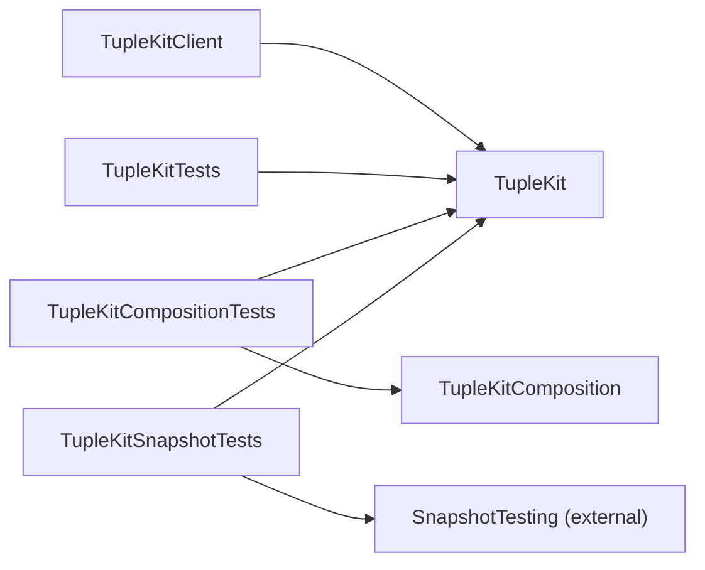

# Architecture

## Purpose

---

TupleKit is a Swift Package Manager library for fixed-shape product values. The public `Tuple<each Member>` stores its members in a built-in tuple, preserving each member's static type. Runtime access is explicit through `member(at:as:)` and `erasedMembers`; `Tuple` is not a `Collection`. See [`Sources/TupleKit/Tuple.swift`](Sources/TupleKit/Tuple.swift), [`README.md`](README.md), and [ADR 0001](docs/adr/0001-tuple-is-a-product-value-not-a-collection.md).

[`Package.swift`](Package.swift) declares two independent library products (`TupleKit` and `TupleKitComposition`), the `TupleKitClient` example executable, and three test targets. `SnapshotTesting` is linked only by `TupleKitSnapshotTests`; SwiftPM may still resolve test dependencies for a consumer. Neither library product has an external runtime dependency or requires a service. [ADR 0003](docs/adr/0003-rename-the-package-to-tuplekit.md) explains the rename from HeterogeneousBox.

## Repository map

---

| Path | Responsibility |
| --- | --- |
| [Package.swift](Package.swift) | Products, targets, platforms, and Swift language mode. |
| [Sources/TupleKit/](Sources/TupleKit/) | Core value, typed transforms, conditional conformances, and asynchronous zip. Most operations are grouped in [extensions](Sources/TupleKit/Extension/). |
| [Sources/TupleKitComposition/](Sources/TupleKitComposition/) | Independent composition operators, predicate matching, and in-memory value history. |
| [Sources/TupleKitClient/main.swift](Sources/TupleKitClient/main.swift) | Example consumer: constructs, reads, updates, and concatenates a tuple. |
| [Core tests](Tests/TupleKitTests/), [composition tests](Tests/TupleKitCompositionTests/), [snapshot tests](Tests/TupleKitSnapshotTests/) | Public behavior, lifetime and concurrency regressions, and approved textual output. |
| [Positive](Tests/PositiveTypeChecks/), [negative](Tests/NegativeTypeChecks/), and [known-bug fixtures](Tests/KnownCompilerBugs/) | Standalone compiler inputs: supported calls must compile, invalid calls must fail at marked lines, and known compiler bugs remain tracked. |
| [Scripts/](Scripts/), [prek.toml](prek.toml), [GitHub workflows](.github/workflows/) | Local and CI validation, generated concatenation, commit checks, and releases. |
| [DocC](Sources/TupleKit/TupleKit.docc/), [ADRs](docs/adr/), [diagram index](docs/diagrams/README.md) | Public examples, design decisions, and detailed dependency and function maps. |

## Components and data flow

---

The arrows point from each SwiftPM target to its declared target or product dependencies. Neither library depends on the other.



### Core value

[`Tuple`](Sources/TupleKit/Tuple.swift) stores `(repeat each Member)`. Writable key paths into that built-in tuple provide typed reads and writes; `appending(_:)`, mapping, and concatenation return a new `Tuple` with a statically known shape. [`member(at:as:)`](Sources/TupleKit/Extension/Tuple+TypedAccess.swift) checks a runtime position and type and reports `TupleAccessError`. `erasedMembers` explicitly copies the members into `[Any]`. Neither runtime API makes `Tuple` a `Collection`.

### Asynchronous work

[`mapEach`](Sources/TupleKit/Extension/Tuple+AsyncMemberWork.swift) has synchronous and sequential async forms. The async form runs on the caller's actor. `concurrentMapEach` requires `Sendable` inputs, outputs, and transforms. It runs one child task per member, collects results by position, and reconstructs the typed result in source order. Cancellation is cooperative.

[`TupleZipSequence`](Sources/TupleKit/TupleZipSequence.swift) pulls one value per base in order on the caller's task, without creating tasks or adding a buffer. It yields only complete tuples and terminates on an exhausted or throwing base; zero bases yield nothing.

### Conditional conformances and helpers

- `Equatable`, `Hashable`, `Comparable`, `Codable`, and `Sendable` are conditional on member capabilities.
- String and debug descriptions and custom reflection expose the stored members.
- `unwrapped(_:)`, `collected(_:)`, and `values(of:)` combine tuples of wrappers without erasing member types.
- [`TuplePattern`](Sources/TupleKit/TuplePattern.swift) checks one predicate per member, stopping at the first nonmatch. It belongs to the core product; the composition product's `PredicatePattern` works with any value type.
- [`ElementwiseTuple`](Sources/TupleKit/ElementwiseTuple.swift) provides `AdditiveArithmetic` when every member supports it. The wrapper keeps memberwise addition separate from `Tuple`'s `+`, which concatenates.

### Composition helpers

`TupleKitComposition` does not depend on `TupleKit`. It provides [synchronous function composition](Sources/TupleKitComposition/Operators/FunctionComposition.swift), [predicate-based switch matching](Sources/TupleKitComposition/PredicatePattern.swift), and [bounded or unbounded in-memory value history](Sources/TupleKitComposition/AccumulatingValue.swift). Composition tests import both products to exercise their use together.

## Boundaries and constraints

---

- The package targets macOS 14 and iOS 17, declares Swift tools 6.4.2, and uses Swift 6 language mode (`Package.swift`). Generic types with parameter packs require the iOS 17 runtime. Swift 6.4.2 is the verified minimum for nonescaping callbacks over a single-member pack.
- The products do not persist data or make network calls. Storage and networking belong to the consumer.
- On Swift 6.4.2, use `tuple[\.self]` or `tuple.members` for one-member tuples rather than `tuple.0`. Bind the result of `zipToTuples` before iterating it. Both work around compiler issues documented in [UseCases.md](Sources/TupleKit/TupleKit.docc/UseCases.md).
- [Concatenation](Sources/TupleKit/Extension/Tuple+Concatenation.swift) treats an empty right operand as an identity and uses generated overloads for right operands of one to six members. Change the [generator](Scripts/generate-concatenation.py), not the generated Swift. A single two-pack overload is a possible simplification after a compiler fix, not current behavior. See [ADR 0002](docs/adr/0002-concatenation-overloads-by-right-arity.md).

## Development and validation

---

Use Swift Package Manager from the repository root. See [ONBOARDING.md](ONBOARDING.md) for prerequisites and the full setup sequence.

```sh
swift build
SNAPSHOT_TESTING_RECORD=never swift test
swift run TupleKitClient
```

For API changes, run `Scripts/check-compiler-contracts.sh` and `python3 Scripts/check-doc-snippets.py --run` alongside the Swift Testing suites. For edited Swift files, follow [AGENTS.md](AGENTS.md); `bash Scripts/swift-style check --all` runs the formatter and SwiftLint checks with the tools pinned in [`.swift-style.env`](.swift-style.env). [`prek.toml`](prek.toml) defines the optional Git hooks.

On `main` pushes and pull requests targeting `main`, the [Swift workflow](.github/workflows/swift.yml) runs macOS and Linux builds, tests, compiler contracts, DocC examples, and sanitizers. Linux CI disables Address Sanitizer's leak detection because of leaks in the Swift 6.4.2 XCTest runtime. The macOS jobs also check both iOS 17 library builds, generated code, golden snapshots, Python tooling tests, and a combined 96% line-coverage minimum for the two libraries. The reusable [quality workflow](.github/workflows/swift-quality.yml) runs style and clean-build compiler analysis. The [release workflow](.github/workflows/release.yml) publishes package versions when eligible `main` pushes pass validation; it does not deploy an app or service. See [CONTRIBUTING.md](CONTRIBUTING.md) for release and snapshot policy.

## Glossary

---

Use [GLOSSARY.md](GLOSSARY.md) for project terminology. A **member** is one value at a fixed **position**; the **shape** is the ordered list of member types. A Swift parameter pack (`each` / `repeat`) expresses that shape in `Tuple<each Member>`.
