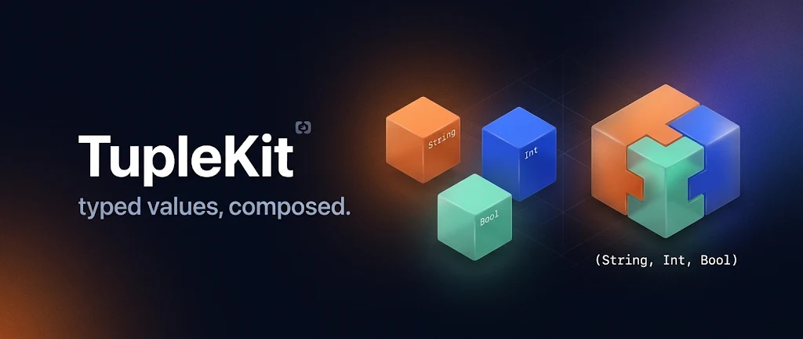
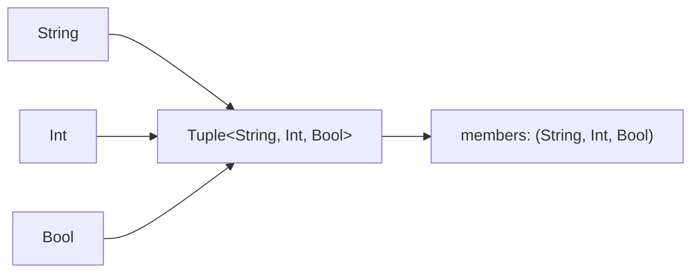
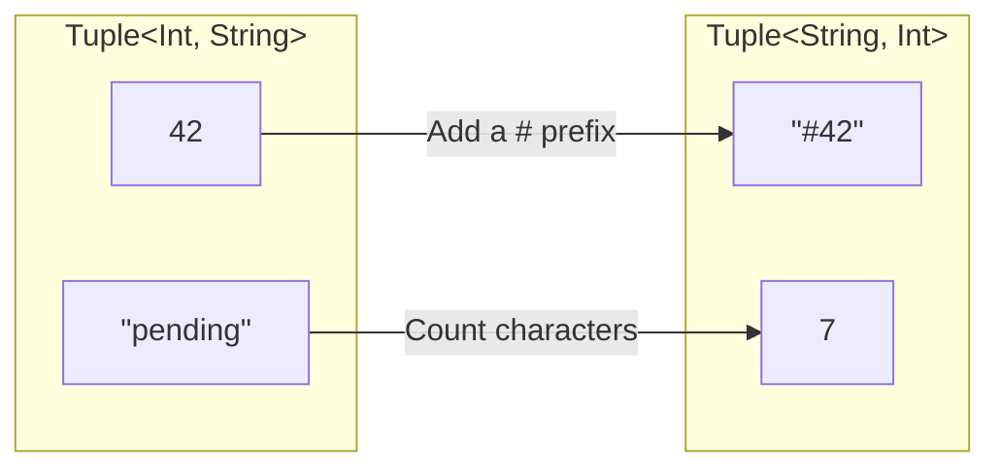
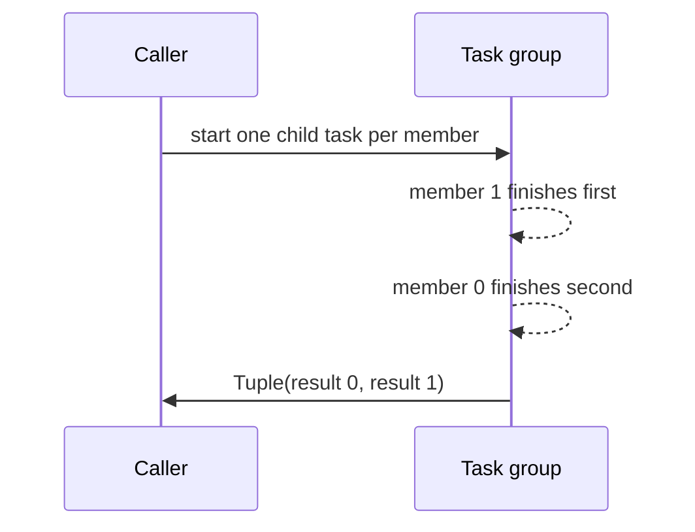
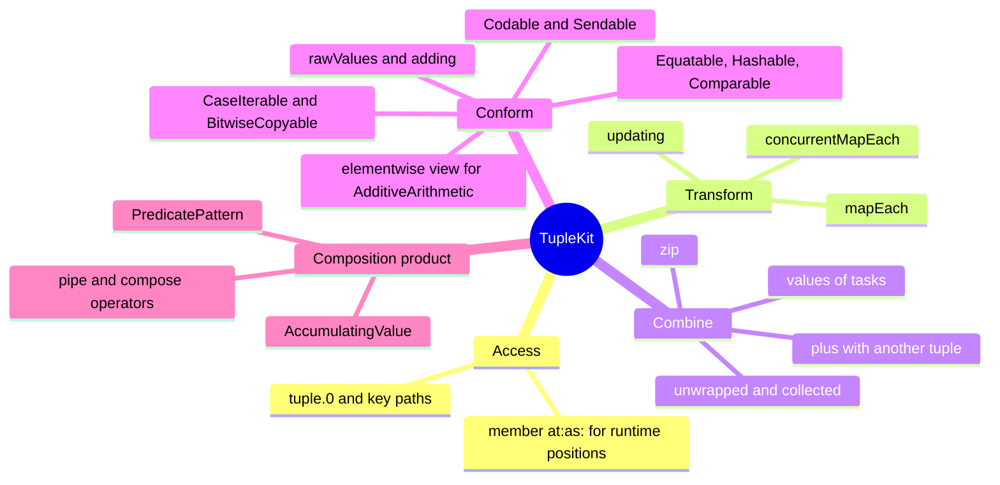

<p align="center">
  
</p>

# TupleKit


[](https://swiftpackageindex.com/brunogama/TupleKit)[](https://swiftpackageindex.com/brunogama/TupleKit)

TupleKit provides `Tuple`, a fixed group of values whose members each keep their own static type. It's built on Swift parameter packs, so every read, transform, and comparison is checked by the compiler.

---

## How it works

A `Tuple` stores a built-in Swift tuple. Its member types come from a parameter pack, so the compiler knows the type at every position.



`mapEach` takes one closure per member. Each closure receives its member's type and chooses the output type at that position.



`concurrentMapEach` runs the transforms in child tasks and returns the results in position order, whatever order the tasks finish in.



---

## Quick start

```swift
import TupleKit

var order = Tuple(42, "pending", true)
order.1 = "shipped"

let labels = order.mapEach({ "#\($0)" }, { $0.uppercased() }, { $0 ? "paid" : "unpaid" })
// labels is Tuple<String, String, String>

let withTotal = order + Tuple(19.9)
// withTotal is Tuple<Int, String, Bool, Double>
```

---

## Features



---

## Installation

<!-- snippet: skip -->
```swift
dependencies: [
    .package(url: "https://github.com/brunogama/TupleKit.git", from: "1.0.0")
],
targets: [
    .target(
        name: "YourTarget",
        dependencies: [
            .product(name: "TupleKit", package: "TupleKit"),
            .product(name: "TupleKitComposition", package: "TupleKit"),
        ]
    )
]
```

TupleKit requires Swift 6.4.2 and iOS 17 or macOS 14. Swift 6.2 rejects nonescaping
callback packs for single-member tuples; the minimum preserves those public APIs.

### Binary installation

Each [GitHub release](https://github.com/brunogama/TupleKit/releases) includes
XCFramework ZIPs for both libraries and a checksum-pinned `Package.binary.swift`.
Download the manifest, save it as `Package.swift` in a local directory named
`TupleKit`, and add that directory as a local package in Xcode. Both products
support macOS, iOS devices, and iOS Simulator. The normal Git dependency above
still builds from source.

---

## Learn more

- [Use cases](Sources/TupleKit/TupleKit.docc/UseCases.md): every API, with examples and known compiler limits.
- [Contributing](CONTRIBUTING.md): commit conventions and automatic releases.
- [WWDC23: Generalize APIs with parameter packs](https://developer.apple.com/videos/play/wwdc2023/10168)

---

## License

TupleKit is developed by [Bruno Gama](https://github.com/brunogama) and is available under the MIT license. See the LICENSE file for more info.
