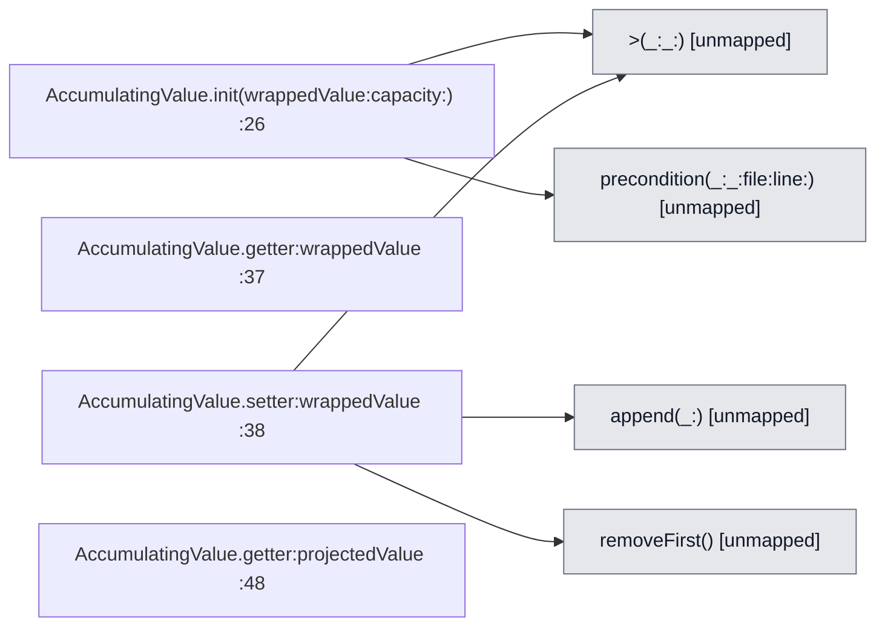
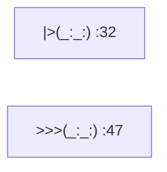
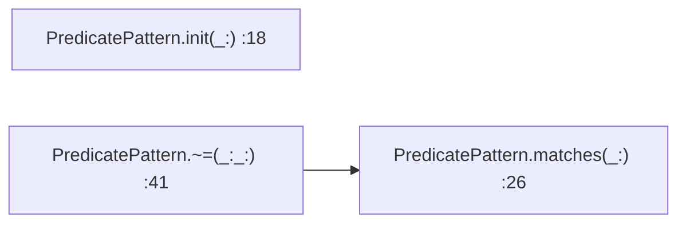

# Function map: TupleKitComposition

One chart per file. Nodes list explicit Swift callable declarations with source lines. Arrows show compiler-resolved references to functions, including calls and function values. Gray nodes are callees declared elsewhere; a shaded node with no project location is not mapped to a declaration in these charts.

---

## AccumulatingValue.swift

[`Sources/TupleKitComposition/AccumulatingValue.swift`](../../Sources/TupleKitComposition/AccumulatingValue.swift)

---

## FunctionComposition.swift

[`Sources/TupleKitComposition/Operators/FunctionComposition.swift`](../../Sources/TupleKitComposition/Operators/FunctionComposition.swift)

---

## PredicatePattern.swift

[`Sources/TupleKitComposition/PredicatePattern.swift`](../../Sources/TupleKitComposition/PredicatePattern.swift)

