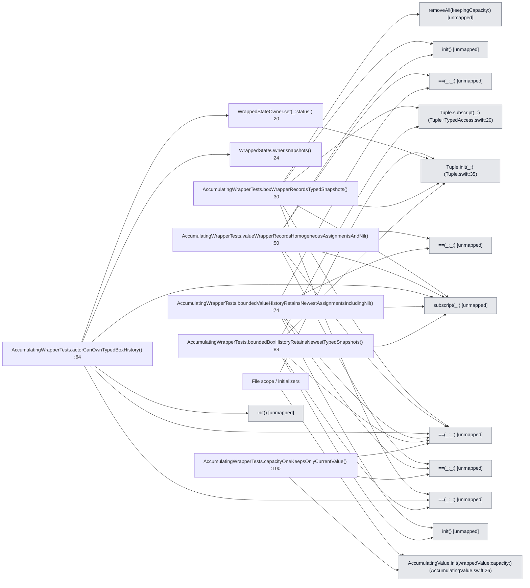
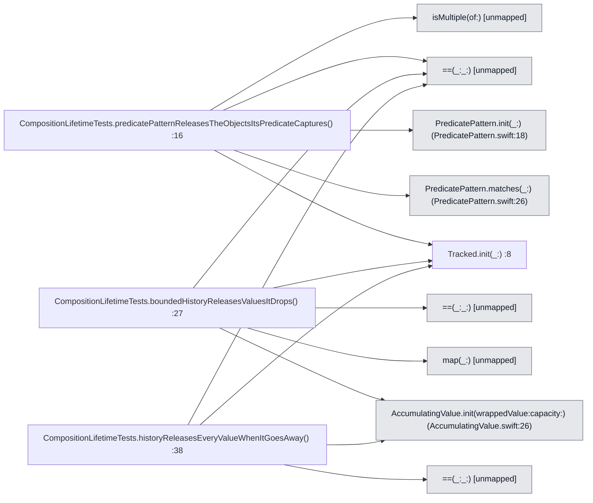
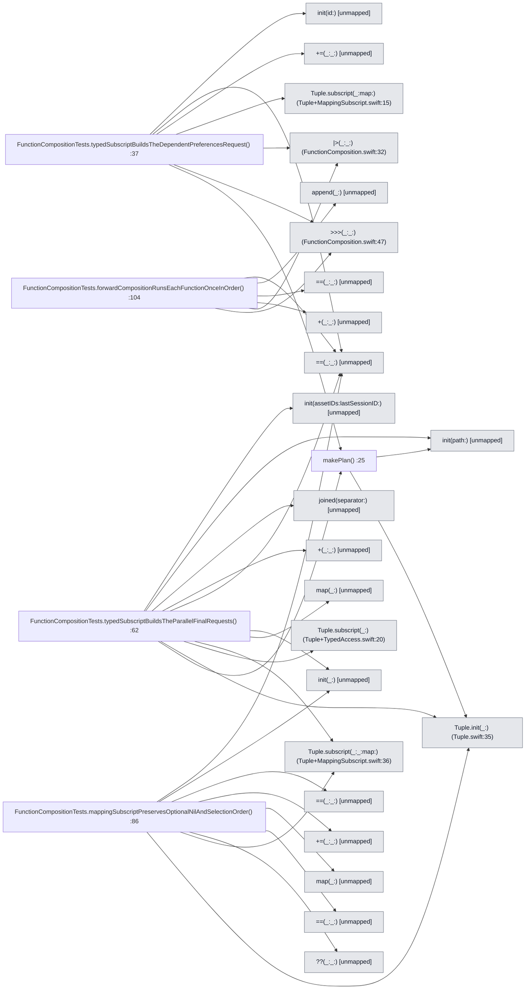
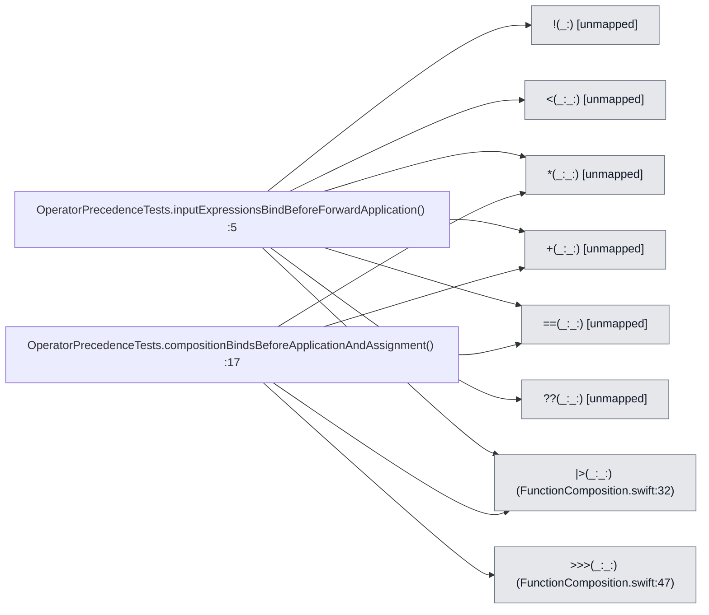
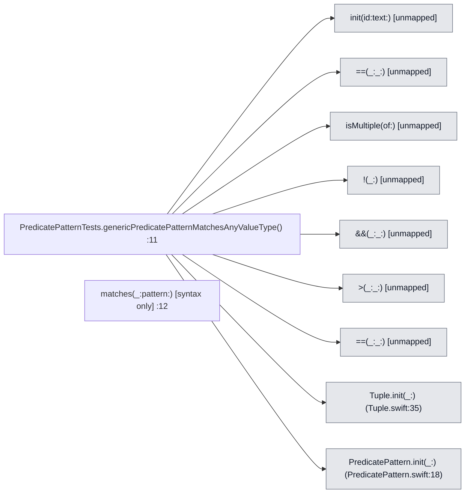

# Function map: TupleKitCompositionTests

One chart per file. Nodes list explicit Swift callable declarations with source lines. Arrows show compiler-resolved references to functions, including calls and function values. Gray nodes are callees declared elsewhere; a shaded node with no project location is not mapped to a declaration in these charts.

---

## AccumulatingWrapperTests.swift

[`Tests/TupleKitCompositionTests/AccumulatingWrapperTests.swift`](../../Tests/TupleKitCompositionTests/AccumulatingWrapperTests.swift)

---

## CompositionLifetimeTests.swift

[`Tests/TupleKitCompositionTests/CompositionLifetimeTests.swift`](../../Tests/TupleKitCompositionTests/CompositionLifetimeTests.swift)

---

## FunctionCompositionTests.swift

[`Tests/TupleKitCompositionTests/FunctionCompositionTests.swift`](../../Tests/TupleKitCompositionTests/FunctionCompositionTests.swift)

---

## OperatorPrecedenceTests.swift

[`Tests/TupleKitCompositionTests/OperatorPrecedenceTests.swift`](../../Tests/TupleKitCompositionTests/OperatorPrecedenceTests.swift)

---

## PredicatePatternTests.swift

[`Tests/TupleKitCompositionTests/PredicatePatternTests.swift`](../../Tests/TupleKitCompositionTests/PredicatePatternTests.swift)

