# Function map: TupleKitTests

One chart per file. Nodes list explicit Swift callable declarations with source lines. Arrows show compiler-resolved references to functions, including calls and function values. Gray nodes are callees declared elsewhere; a shaded node with no project location is not mapped to a declaration in these charts.

---

## AdditionalConformanceTests.swift

[`Tests/TupleKitTests/AdditionalConformanceTests.swift`](../../Tests/TupleKitTests/AdditionalConformanceTests.swift)

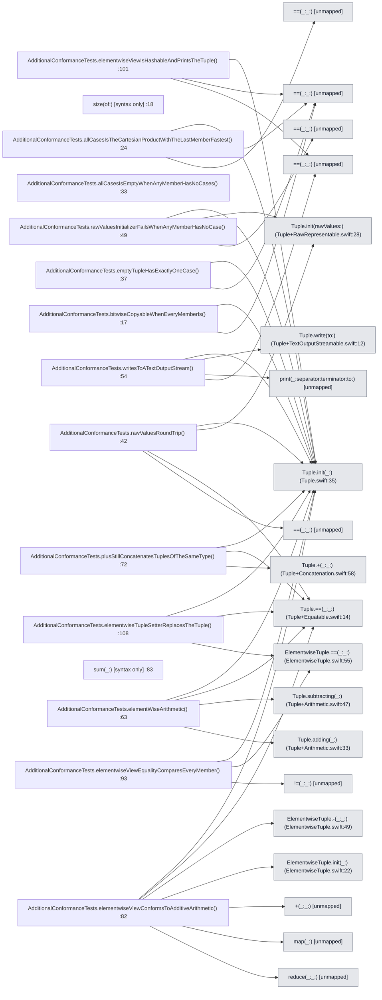

---

## AppendTests.swift

[`Tests/TupleKitTests/AppendTests.swift`](../../Tests/TupleKitTests/AppendTests.swift)

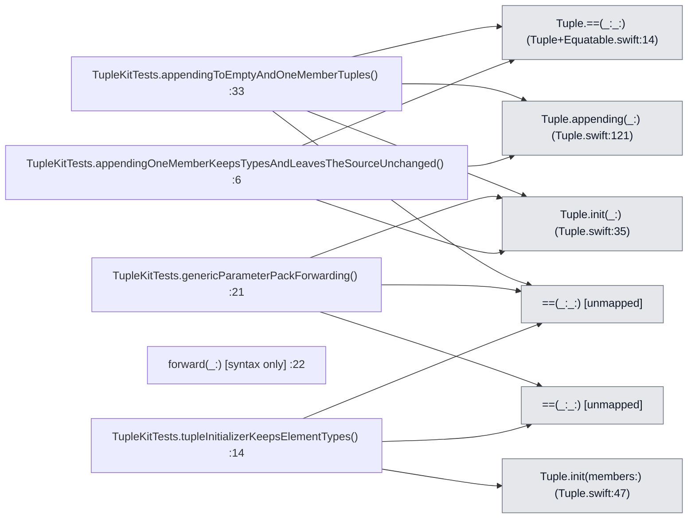

---

## AsyncMemberWorkTests.swift

[`Tests/TupleKitTests/AsyncMemberWorkTests.swift`](../../Tests/TupleKitTests/AsyncMemberWorkTests.swift)

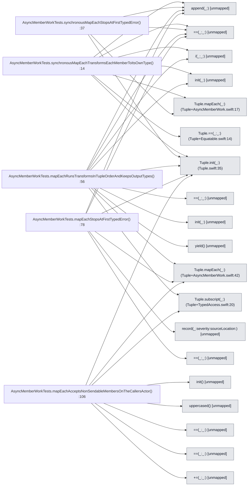

---

## CombiningTests.swift

[`Tests/TupleKitTests/CombiningTests.swift`](../../Tests/TupleKitTests/CombiningTests.swift)

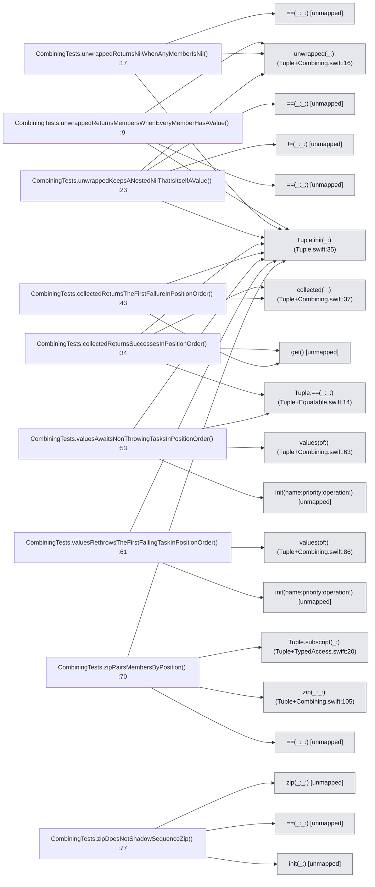

---

## ConcurrentMapEachTests.swift

[`Tests/TupleKitTests/ConcurrentMapEachTests.swift`](../../Tests/TupleKitTests/ConcurrentMapEachTests.swift)

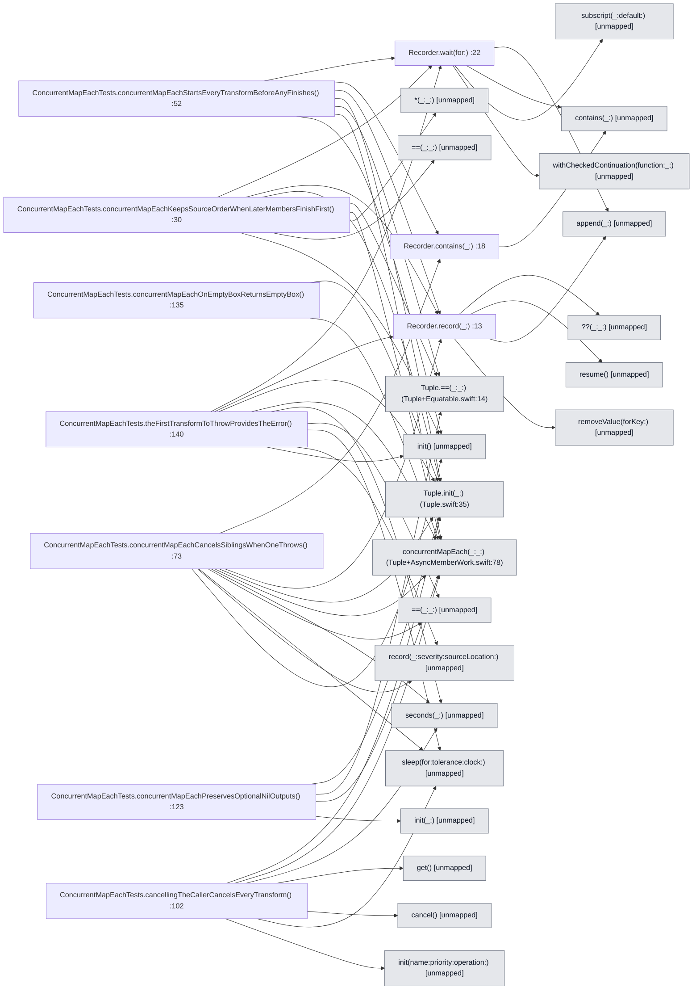

---

## ConformanceTests.swift

[`Tests/TupleKitTests/ConformanceTests.swift`](../../Tests/TupleKitTests/ConformanceTests.swift)

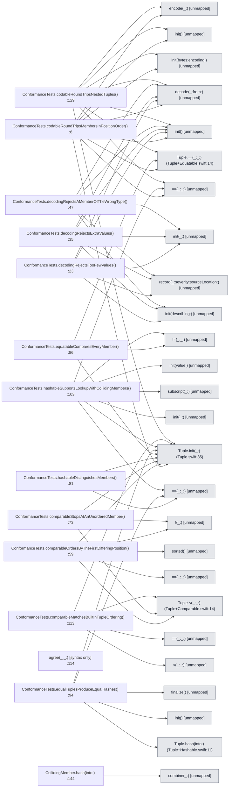

---

## GenericClientTests.swift

[`Tests/TupleKitTests/GenericClientTests.swift`](../../Tests/TupleKitTests/GenericClientTests.swift)

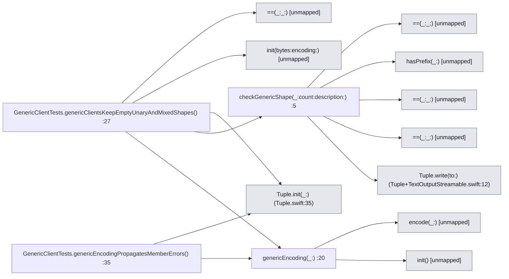

---

## LifetimeTests.swift

[`Tests/TupleKitTests/LifetimeTests.swift`](../../Tests/TupleKitTests/LifetimeTests.swift)

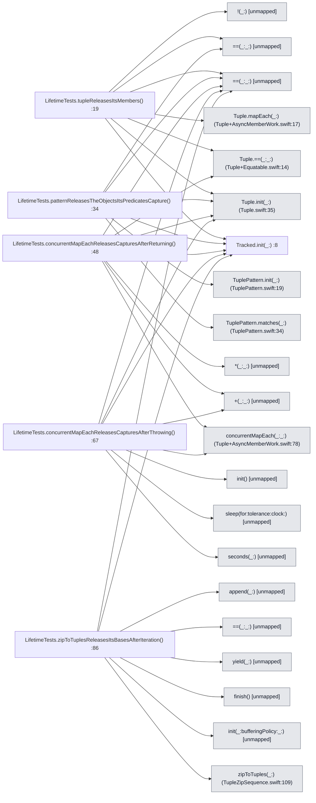

---

## MirrorTests.swift

[`Tests/TupleKitTests/MirrorTests.swift`](../../Tests/TupleKitTests/MirrorTests.swift)

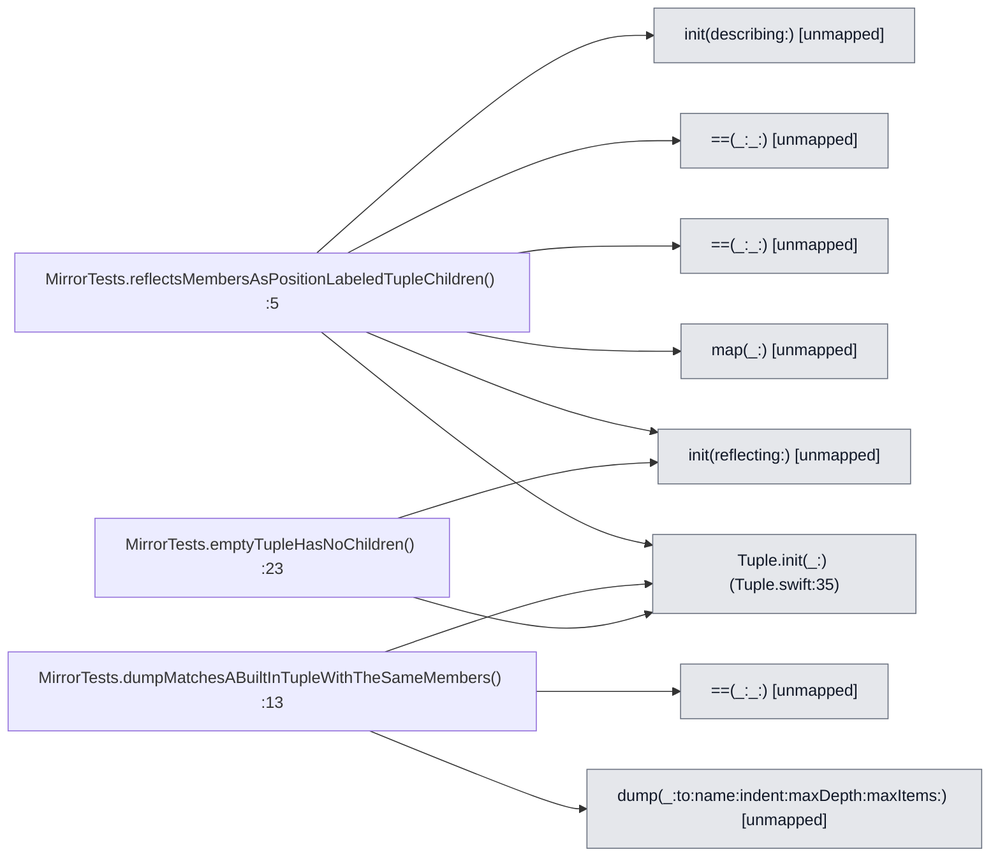

---

## NestedFocusTests.swift

[`Tests/TupleKitTests/NestedFocusTests.swift`](../../Tests/TupleKitTests/NestedFocusTests.swift)

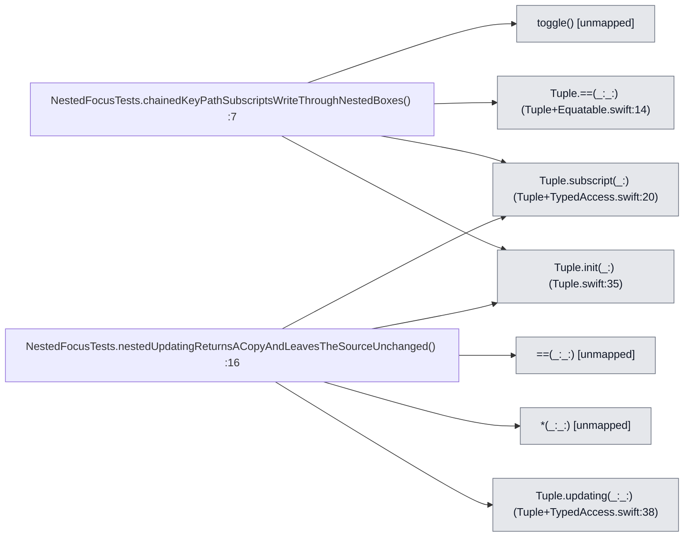

---

## OperatorsAndHigherOrderTests.swift

[`Tests/TupleKitTests/OperatorsAndHigherOrderTests.swift`](../../Tests/TupleKitTests/OperatorsAndHigherOrderTests.swift)

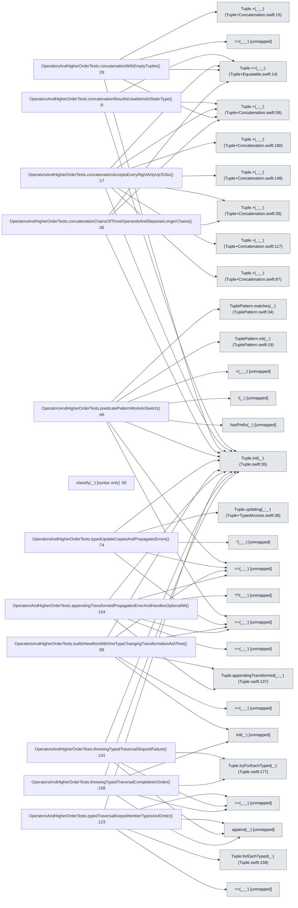

---

## PlaygroundDisplayTests.swift

[`Tests/TupleKitTests/PlaygroundDisplayTests.swift`](../../Tests/TupleKitTests/PlaygroundDisplayTests.swift)

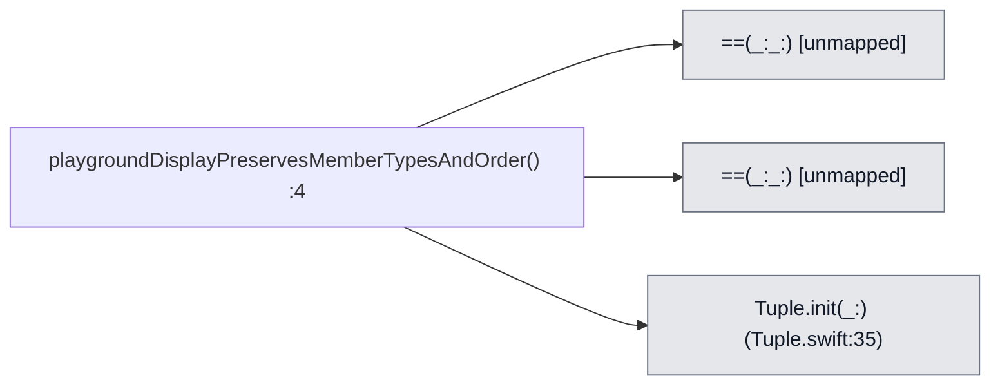

---

## ShapeTests.swift

[`Tests/TupleKitTests/ShapeTests.swift`](../../Tests/TupleKitTests/ShapeTests.swift)

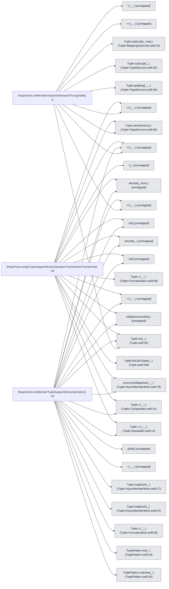

---

## TaskValueLifetimeTests.swift

[`Tests/TupleKitTests/TaskValueLifetimeTests.swift`](../../Tests/TupleKitTests/TaskValueLifetimeTests.swift)

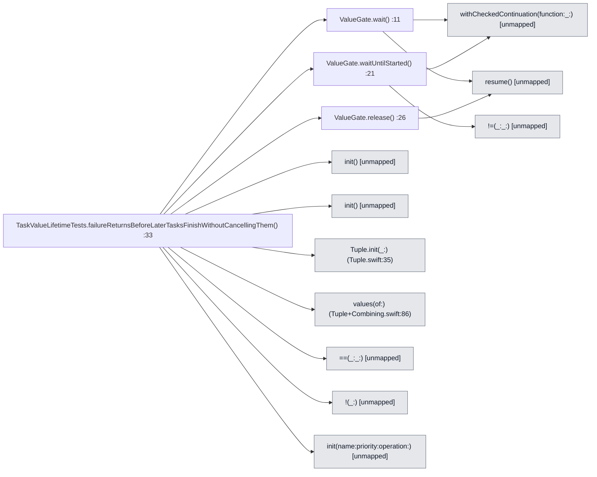

---

## TupleTests.swift

[`Tests/TupleKitTests/TupleTests.swift`](../../Tests/TupleKitTests/TupleTests.swift)

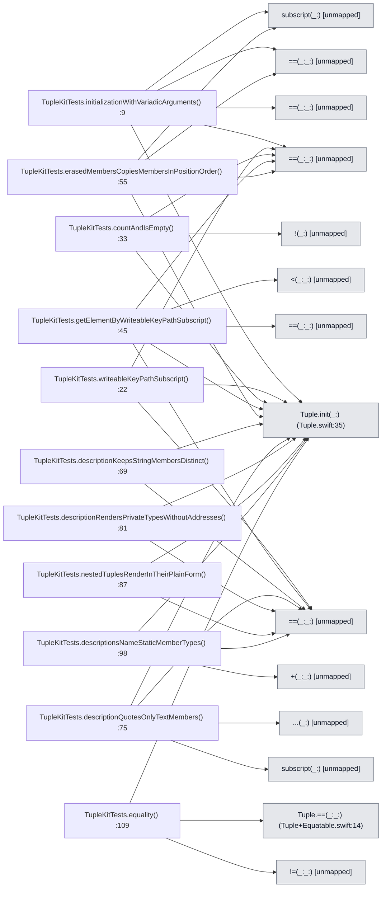

---

## TypedAccessTests.swift

[`Tests/TupleKitTests/TypedAccessTests.swift`](../../Tests/TupleKitTests/TypedAccessTests.swift)

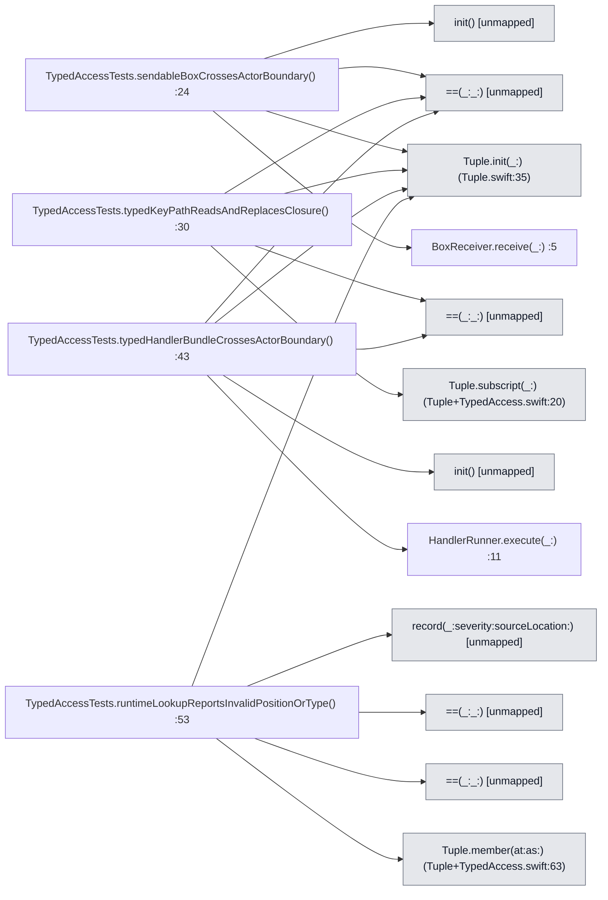

---

## ZipResourceLifetimeTests.swift

[`Tests/TupleKitTests/ZipResourceLifetimeTests.swift`](../../Tests/TupleKitTests/ZipResourceLifetimeTests.swift)

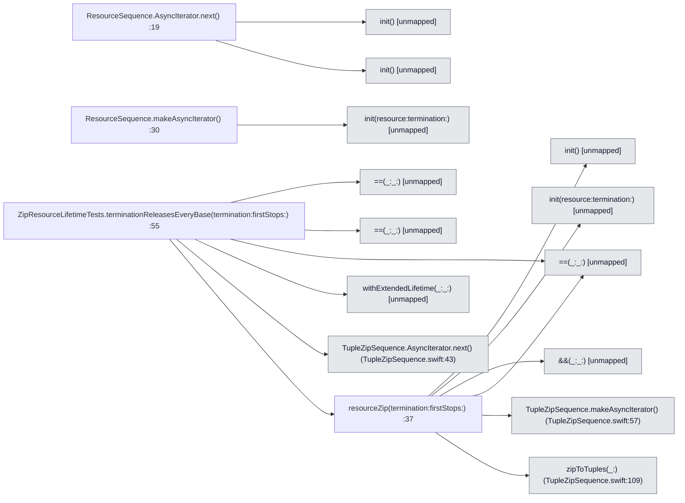

---

## ZipToTuplesTests.swift

[`Tests/TupleKitTests/ZipToTuplesTests.swift`](../../Tests/TupleKitTests/ZipToTuplesTests.swift)

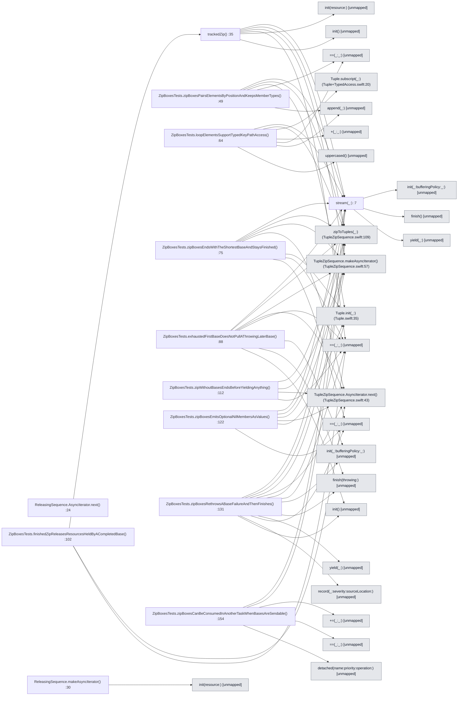
