# Dependencies

Arrows point from a consumer to its dependency. The SwiftPM target and package graphs are separate: a resolved package is not necessarily linked into a library product.

---

## SwiftPM products and targets

From [`Package.swift`](../../Package.swift) and `swift package describe --type json`. Both library targets have no third-party product dependency.

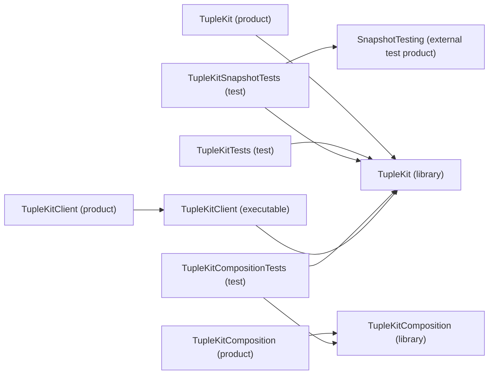

---

## Resolved external packages

From `swift package show-dependencies --format json`, checked against the local, Git-ignored `Package.resolved`. The root declaration supports the snapshot test target.

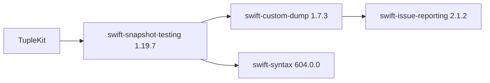

---

## Imports by SwiftPM target

Source imports, not linker edges. Implicit Swift imports are not included; imports inside conditional compilation blocks are shown regardless of platform. Isolated files have no explicit imports.

### TupleKit

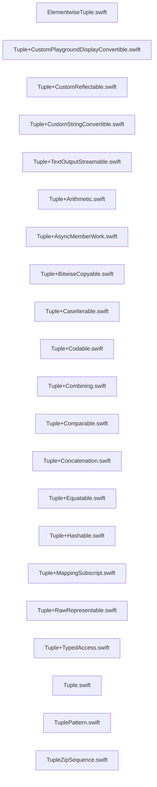

### TupleKitClient

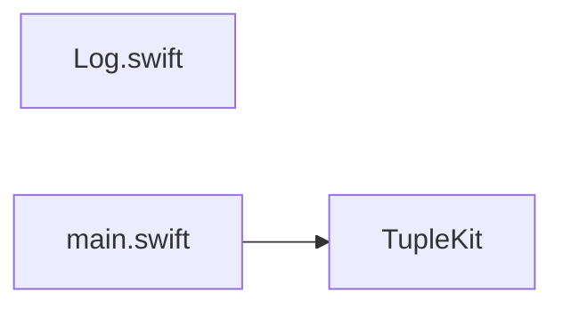

### TupleKitComposition

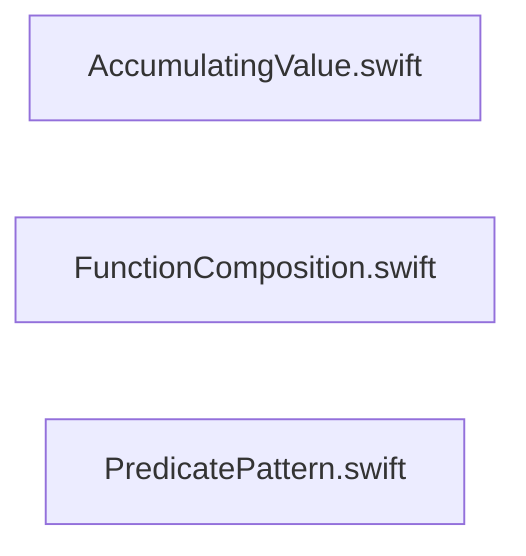

### TupleKitCompositionTests

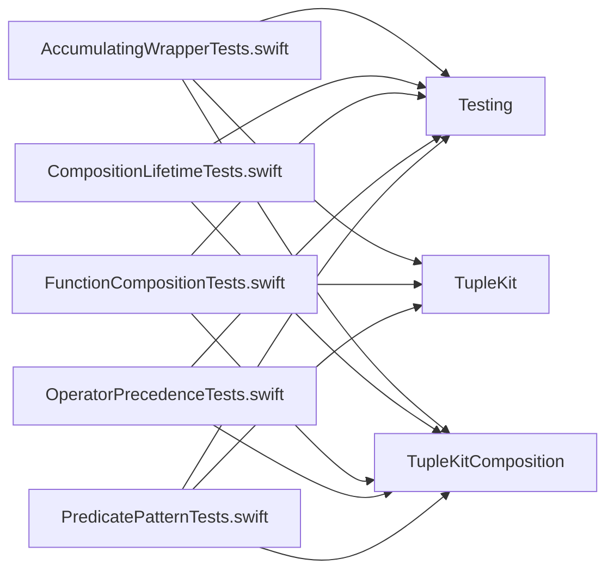

### TupleKitSnapshotTests

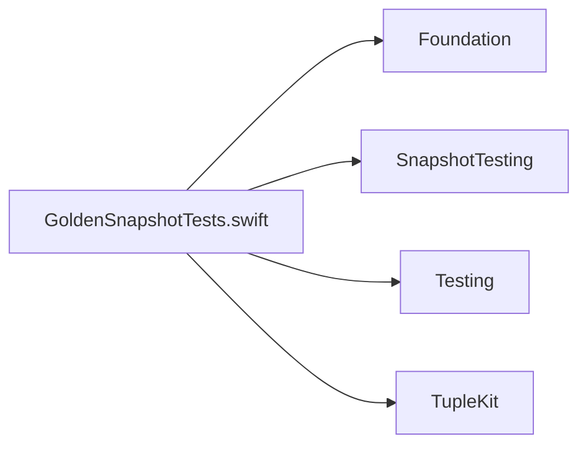

### TupleKitTests

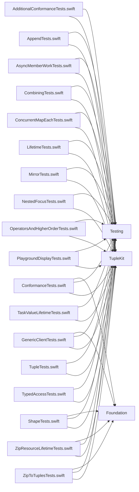

---

## Manifest and standalone Swift fixtures

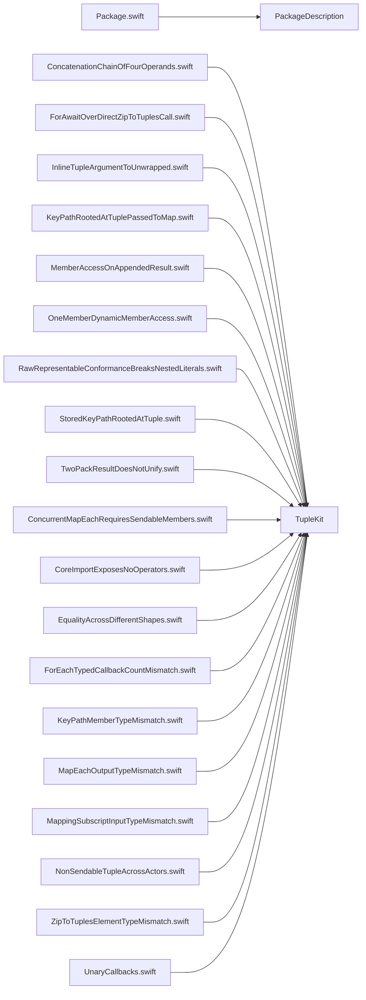

---

## Python tooling imports

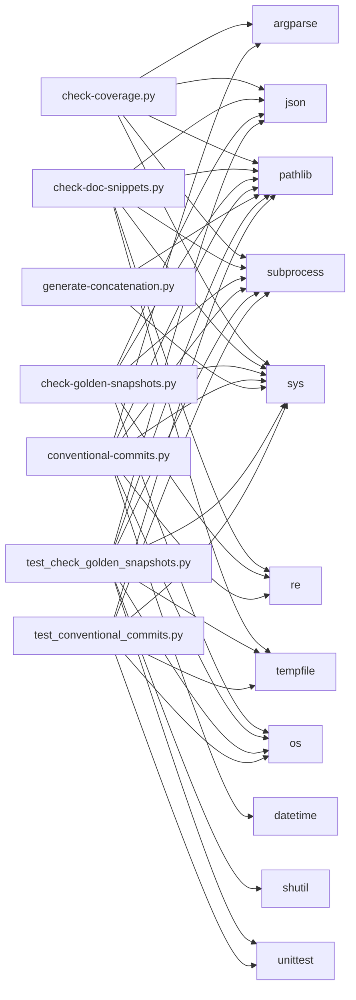

---

## CI and release dependencies

From [the GitHub Actions workflows](../../.github/workflows/) and the tool pins in [`.swift-style.env`](../../.swift-style.env). The release workflow also requires the tested commit to still be the tip of `main`.

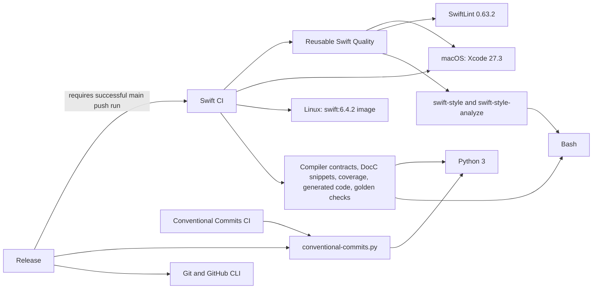
