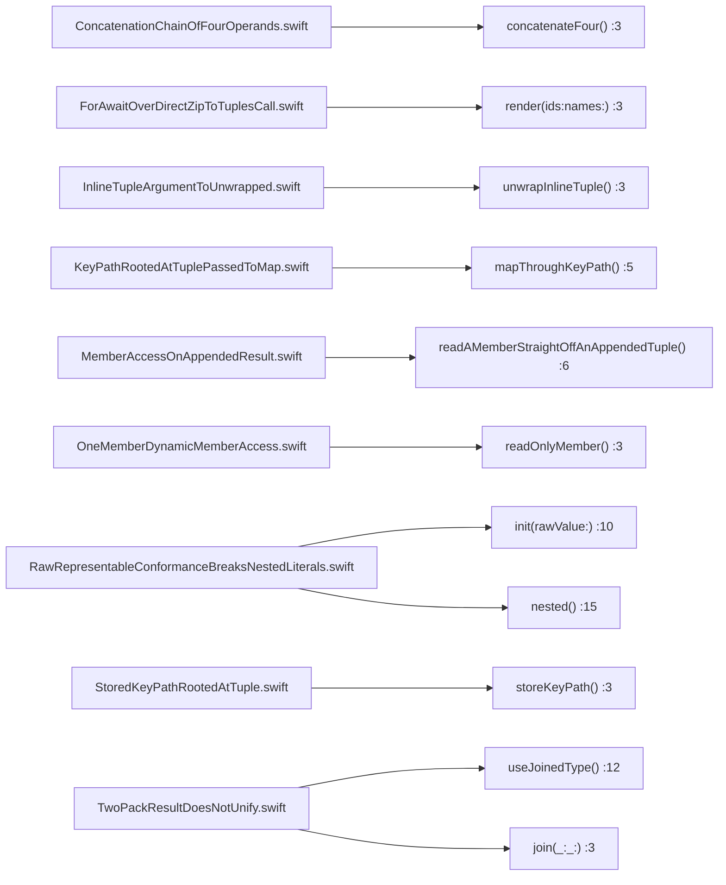
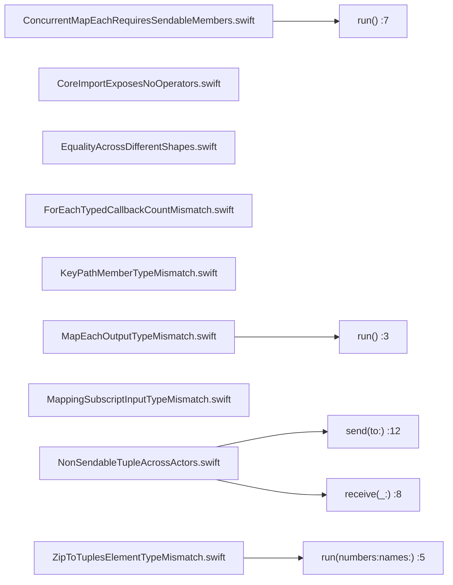
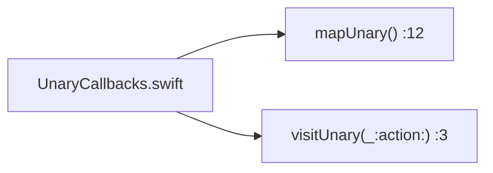

# Standalone Swift fixtures

These are not SwiftPM targets. Declarations come from `swiftc -frontend -dump-parse`. Negative and known-compiler-bug inputs may intentionally fail type-checking, so these are containment diagrams, not resolved call graphs.

---

## Tests/KnownCompilerBugs

---

## Tests/NegativeTypeChecks

---

## Tests/PositiveTypeChecks

