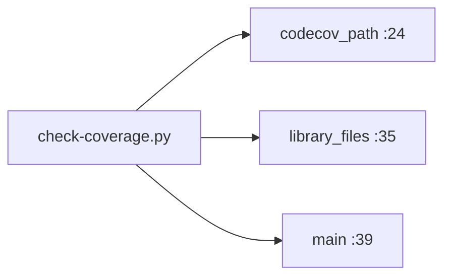
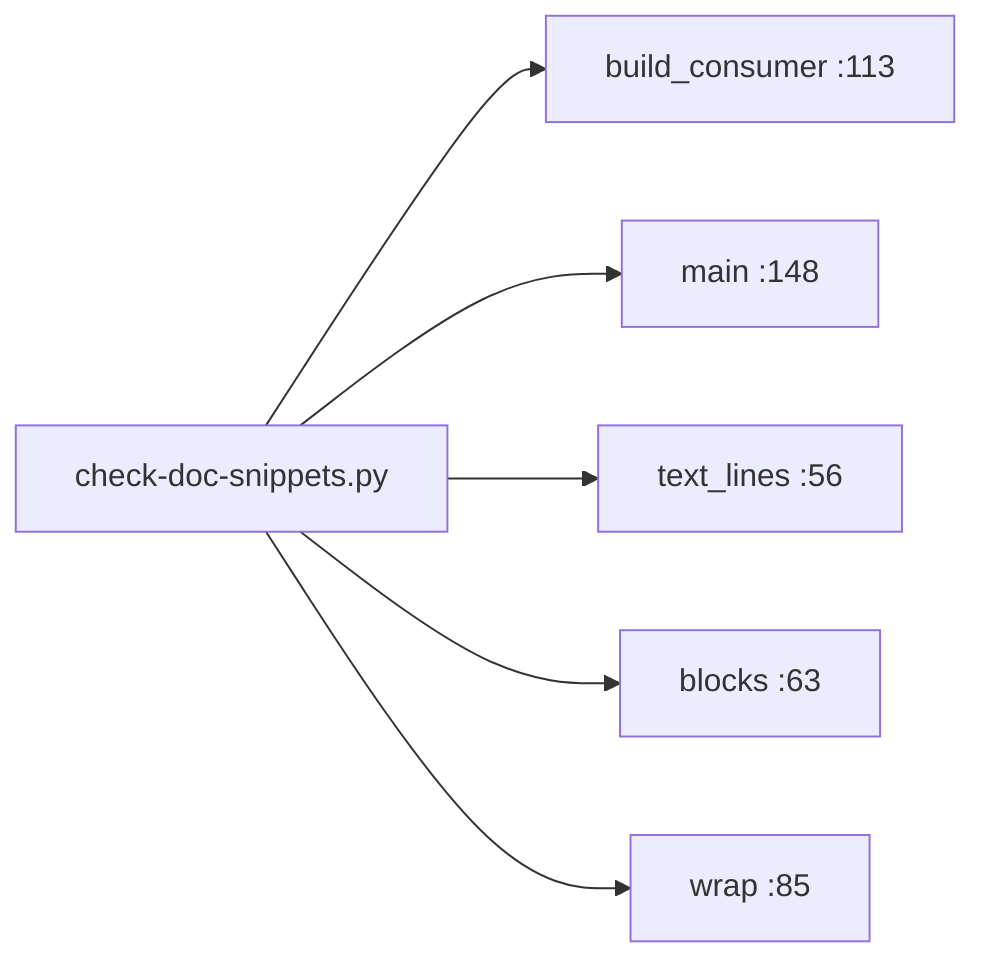
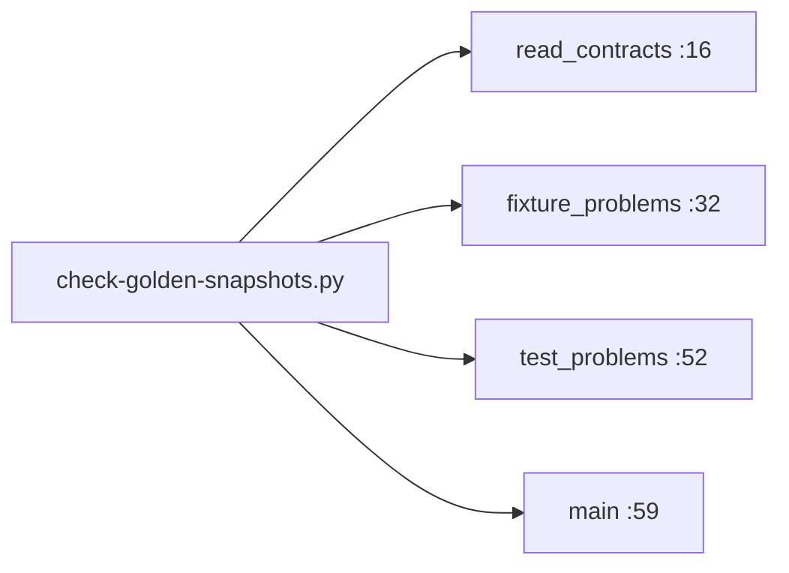
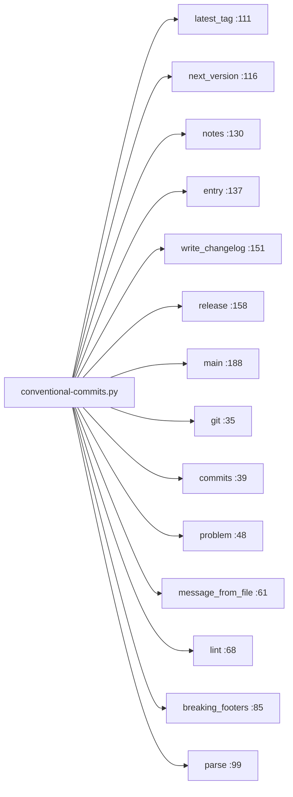
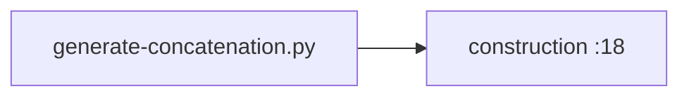
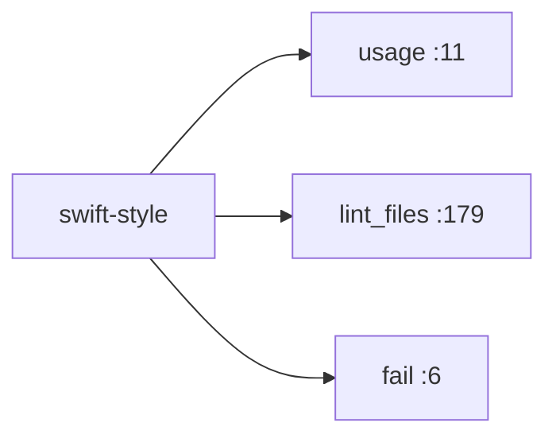
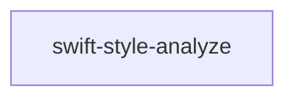
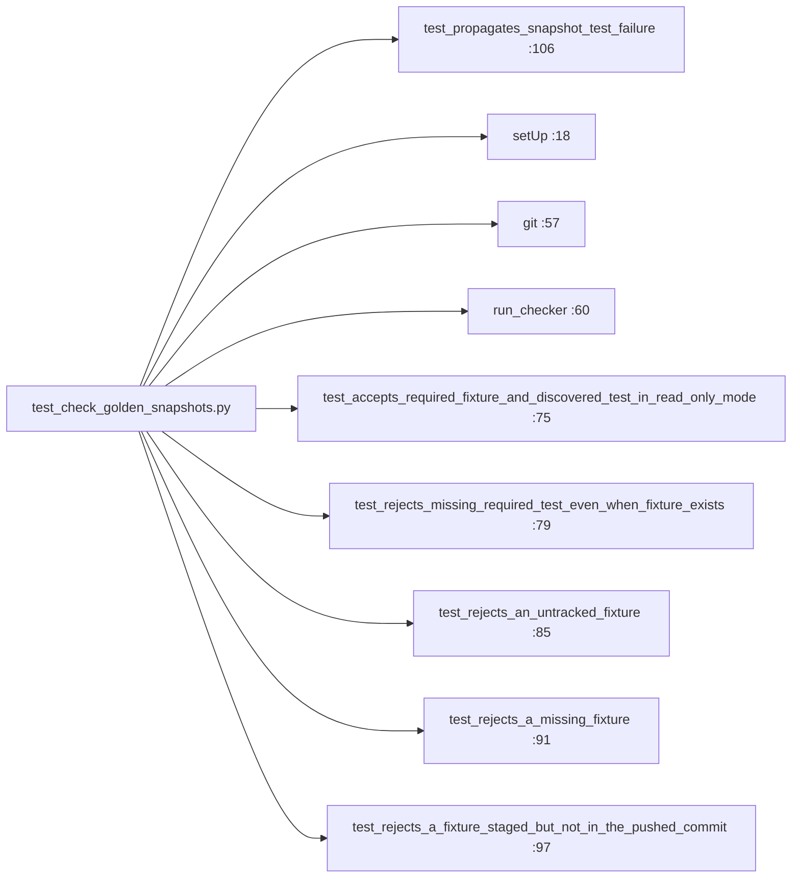
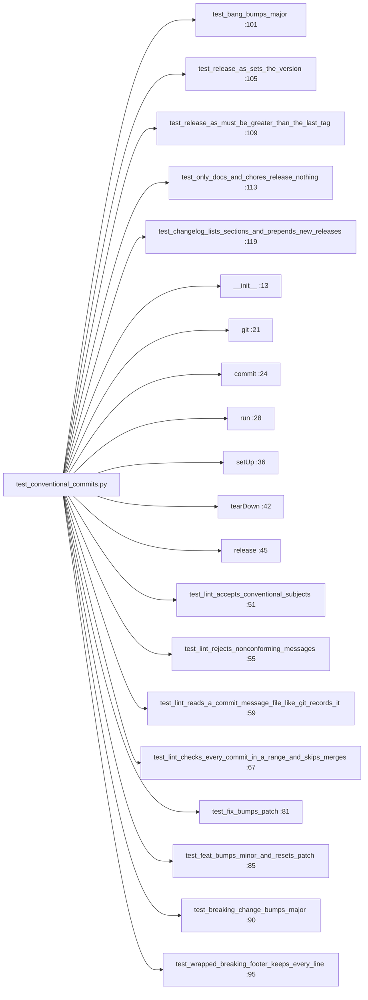

# Repository tooling functions

Diagrams show containment of named functions in repository-owned Python and Bash scripts, not execution order. Python declarations come from `ast`. Bash diagrams include named `name() {` declarations.

---

## check-compiler-contracts.sh

[`Scripts/check-compiler-contracts.sh`](../../Scripts/check-compiler-contracts.sh)

---

## check-coverage.py

[`Scripts/check-coverage.py`](../../Scripts/check-coverage.py)

---

## check-doc-snippets.py

[`Scripts/check-doc-snippets.py`](../../Scripts/check-doc-snippets.py)

---

## check-golden-snapshots.py

[`Scripts/check-golden-snapshots.py`](../../Scripts/check-golden-snapshots.py)

---

## conventional-commits.py

[`Scripts/conventional-commits.py`](../../Scripts/conventional-commits.py)

---

## generate-concatenation.py

[`Scripts/generate-concatenation.py`](../../Scripts/generate-concatenation.py)

---

## swift-style

[`Scripts/swift-style`](../../Scripts/swift-style)

---

## swift-style-analyze

[`Scripts/swift-style-analyze`](../../Scripts/swift-style-analyze)

---

## test_check_golden_snapshots.py

[`Scripts/test_check_golden_snapshots.py`](../../Scripts/test_check_golden_snapshots.py)

---

## test_conventional_commits.py

[`Scripts/test_conventional_commits.py`](../../Scripts/test_conventional_commits.py)

